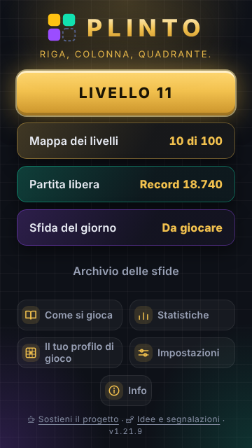
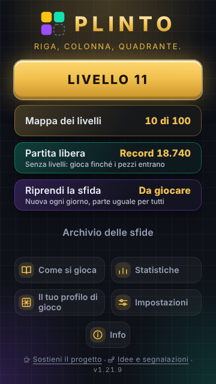
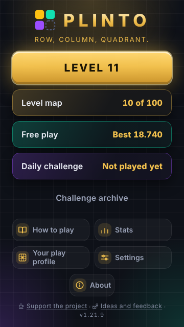
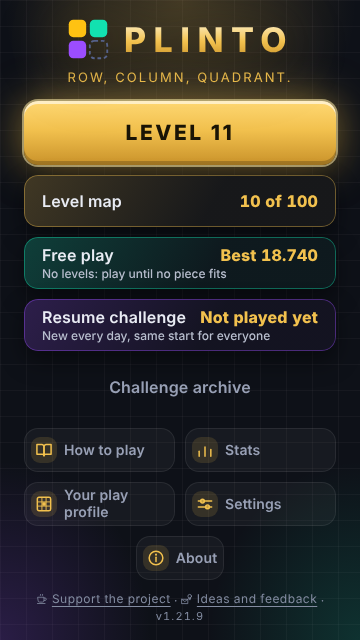
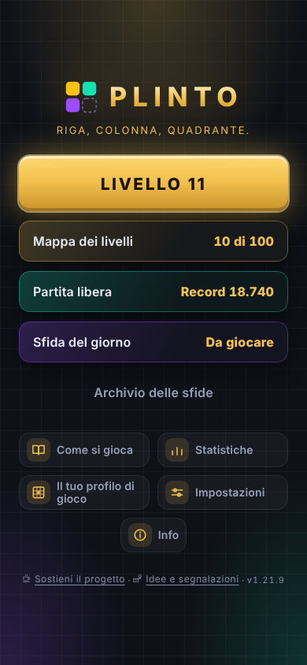
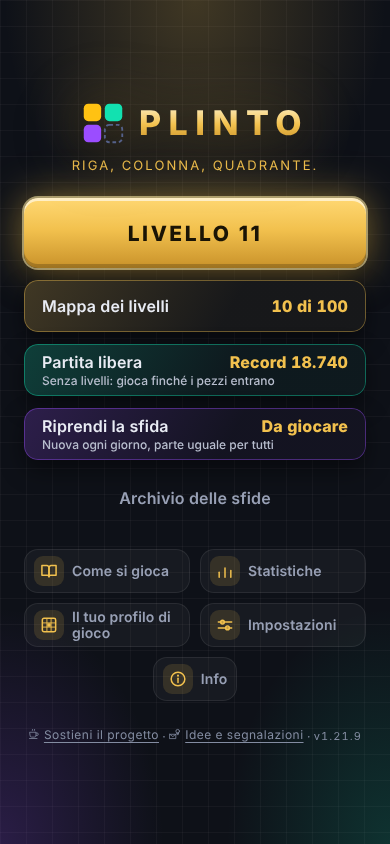
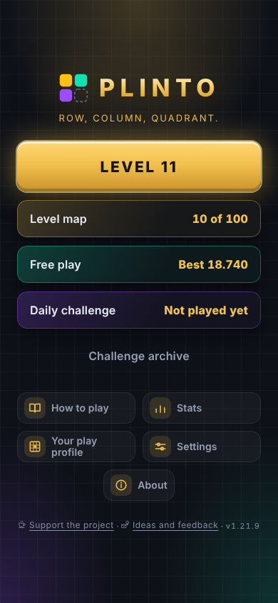
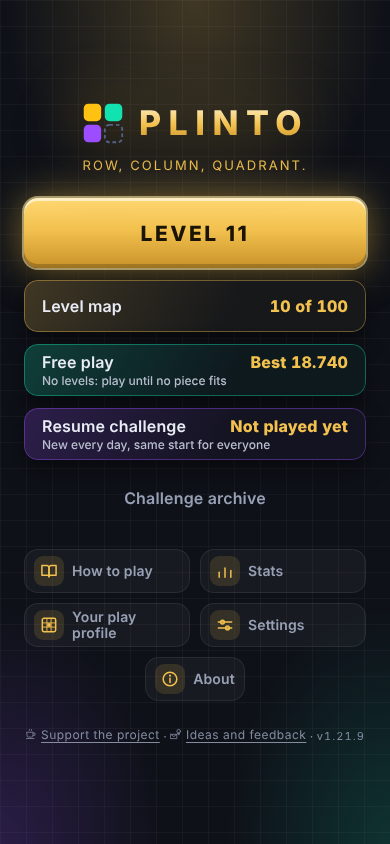

# Rapporto PO-009 — riga di spiegazione sotto Partita libera e Sfida del giorno

Ramo `sviluppo/home-spiegazione-po009`, partito da `main` `a284a13`. Versione non toccata
(resta 1.21.9), CHANGELOG e ROADMAP non toccati, niente pubblicato.

## Che cosa cambia

Sotto il nome delle due card della home compare una riga piccola e **fissa** che dice che
cos'è la modalità. Lo stato resta a destra, come prima.

```
Partita libera ...................... Record 18.740
Senza livelli: gioca finché i pezzi entrano
Sfida del giorno ........................ Da giocare
Nuova ogni giorno, parte uguale per tutti
```

Differenza dall'anteprima mostrata al PO: la riga non è rientrata sotto il solo nome ma
occupa **tutta la larghezza della card**, sotto nome e stato. Motivo misurato: a 360 px,
con lo stato a destra, al nome restano meno di 160 px e la riga andava a capo; larga
quanto la card sta su una riga sola in tutti i formati (colonna «righe» = `1+1` nelle
tabelle sotto) e la card resta alta 52 px come prima.

## 1. Testi

### Scelti (consigliati)

| | italiano | inglese |
|---|---|---|
| Partita libera | **Senza livelli: gioca finché i pezzi entrano** | **No levels: play until no piece fits** |
| Sfida del giorno | **Nuova ogni giorno, parte uguale per tutti** | **New every day, same start for everyone** |

Chiavi nuove `home.spiegaLibera` e `home.spiegaSfida` in `src/i18n/it.js` e `en.js`
(nessuna chiave esistente rinominata).

Perché sono veri:
- «Senza livelli»: la partita libera non è un livello della mappa; i livelli sono la card
  sopra («Mappa dei livelli»). Distingue le due cose con la parola che il gioco già usa.
- «gioca finché i pezzi entrano»: la partita finisce quando «Nessuno dei pezzi rimasti
  entra più sulla griglia» (`src/i18n/it.js:122`, testo della schermata di fine).
- «Nuova ogni giorno»: il seme della sfida è la data (`src/core/sfida.js:4-5`,
  `docs/GAMEPLAY_RULES.md:665-667`).
- «**parte** uguale per tutti» e non «uguale per tutti»: `docs/GAMEPLAY_RULES.md:670-676`
  dice che **non** è la stessa sequenza di pezzi fino in fondo; le prime sei mani
  coincidono, poi divergono secondo come si gioca. È anche la formula che il gioco usa
  già in `modo.sfidaCosa` («Oggi la partita parte uguale per tutti», `it.js:53`).

### Alternative

| | Partita libera | Sfida del giorno | nota |
|---|---|---|---|
| B (anteprima del PO) | Senza fine: gioca finché c'è posto | Una al giorno, uguale per tutti | «Senza fine» e «finché» si contraddicono; «uguale per tutti» è smentito da GAMEPLAY_RULES:670; «c'è posto» è impreciso (un pezzo può non entrare anche con caselle vuote). **Sconsigliata.** |
| C | Nessun obiettivo, nessun livello | Cambia ogni giorno, rigiocala quanto vuoi | Vera («nessun limite di tentativi», GAMEPLAY_RULES:667), ma non dice perché la sfida è diversa dalla libera (il giorno uguale per tutti). |
| en B | Endless: play while there's room | One a day, the same for everyone | stessi problemi della B italiana |

Il lessico è stato controllato da `tests/lessico.test.js` (verde): nessuna parola vietata.

## 2. Impaginazione — prima e dopo

Misure di `npm run home-spiegazione` (Chromium del container, font di ripiego del
container). `libero` = pixel verticali che avanzano fra il primo e l'ultimo blocco della
home (negativo = manca spazio, la home scorre); `riga` = di quanto la riga nuova allunga
la home (misurata togliendola dal disegno).

Tre stati: **nuova** (primo avvio), **piena** (record, 10 livelli, sfida di oggi in corso:
è lo stato che `npm run impaginazione` intende provare), **libera** (piena + una partita
libera in corso, che aggiunge il pulsante «Nuova partita»).

| formato | stato | libero PRIMA | libero DOPO | riga | card libera / sfida |
|---|---|---|---|---|---|
| 360x640 | nuova | 2 | 2 | 0 | 52 / 52 |
| 360x640 | piena | 2 | 2 | 0 | 52 / 52 |
| 360x640 | libera | **−60** | **−60** | 0 | 52 / 52 |
| 375x667 | nuova / piena | 28 | 28 | 0 | 52 / 52 |
| 375x667 | libera | **−34** | **−34** | 0 | 52 / 52 |
| 390x844 | nuova / piena | 170 | 170 | 0 | 52 / 52 |
| 390x844 | libera | 106 | 106 | 0 | 52 / 52 |
| 412x915 | nuova / piena | 234 | 234 | 0 | 52 / 52 |
| 412x915 | libera | 170 | 170 | 0 | 52 / 52 |
| 1280x800 | nuova / piena | 66 | 66 | 0 | 52 / 52 |
| 1280x800 | libera | 2 | 2 | 0 | 52 / 52 |
| 1366x768 | nuova / piena | 39 | 39 | 0 | 52 / 52 |
| 1366x768 | libera | **−25** | **−25** | 0 | 52 / 52 |

Valori identici in italiano e in inglese. Collegamenti in fondo: 27 e 27 px in tutti i
formati (B10 chiede ≥ 24). Card ≥ 44 px: 52 ovunque. Nessuna ricompattazione è stata
necessaria: **la riga non aggiunge nemmeno un pixel**.

### Difetto trovato, già presente su `main`, NON corretto qui

Con una **partita libera in corso** la home scorre già oggi: 60 px a 360x640, 35 a
375x667, 25 a 1366x768 (misurato su `main` prima di toccare qualunque file, tabella
sopra, colonna PRIMA). `npm run impaginazione` non lo vede perché mette in
`plinto:partita` un segnaposto (`{ segnaposto: true }`, `tests/e2e/impaginazione.mjs:92`)
che la home non riconosce come partita: il pulsante «Nuova partita» non compare e lo
stato provato non è «il più pieno possibile» come dice il suo commento. Verificato
caricando una partita vera (`serializeGame(createGame(...))`): la home a 360x640 è alta
700 px su 640.

Non l'ho corretto perché non è causato da PO-009 e la correzione (recuperare ~60 px
sugli schermi bassi, o spostare «Nuova partita») è una scelta di disegno. Il controllo
nuovo, nello stato `libera`, non pretende che la home entri ma che la riga non la
allunghi (`riga = 0`), e lo dice nell'intestazione. Proposta per una voce separata:
correggere i segnaposto di `impaginazione.mjs` (diventerà rosso) e decidere come
recuperare lo spazio.

## 3. Contrasto WCAG

Il fondo delle card è una sfumatura (`src/styles/finiture.css:69-77`); il controllo
misura sul punto **più chiaro**, il 22% del colore della voce sopra `--pl-ink`.

| colore della riga | Partita libera (verde) | Sfida (viola) |
|---|---|---|
| `--pl-text-dim` (prima prova) | **4.497:1 — sotto 4.5** | 5.73:1 |
| `color-mix(--pl-text 40%, --pl-text-dim)` (scelto) | **6.35:1** | **8.10:1** |

Il primo controllo arrotondava a due decimali e faceva passare 4.497 come 4.5: adesso
tronca. `npm run contrasti` (token di `tokens.css`) resta verde.

## 4. Lettori di schermo

La riga è la **descrizione accessibile** della card (`aria-describedby` →
`#pl-spiega-libera`, `#pl-spiega-sfida`), non parte del nome. Il nome (`aria-label`)
resta quello di prima («Partita libera, Record 18.740», «Riprendi la sfida»…), quindi
nessun selettore delle prove esistenti cambia e un lettore legge prima il nome e lo
stato, poi la spiegazione. Il controllo verifica che la descrizione coincida con il
testo del dizionario.

## 5. Interruttore e prova rosso/verde

`SPIEGAZIONE_MODI` in `src/ui/schermate/Home.jsx`. Spento: nessuna riga, nessun
`aria-describedby`, e il CSS nuovo non scatta (è agganciato a
`.pl-sfida-avvio:has(.pl-sfida-avvio__spiega)`): la home è quella della 1.21.9.

Controllo: `npm run home-spiegazione` (`tests/e2e/home-spiegazione.mjs`), registrato in
`tools/verifica-tutto.mjs` dopo «la home entra nello schermo». 2 lingue × 6 formati × 3
stati = 36 home.

| server | interruttore | esito |
|---|---|---|
| sviluppo (5173) | acceso | **verde**, uscita 0 |
| sviluppo (5173) | spento | **rosso**, uscita 1, 72 errori, tutti «la card … non ha la riga di spiegazione» |
| build di produzione (`npm run build`, `npx vite preview --port 4173`, `PLINTO_E2E_URL=http://127.0.0.1:4173/`) | spento | **rosso**, uscita 1, 72 errori dello stesso tipo |
| build di produzione, stessa procedura | acceso | **verde**, uscita 0 |

## 6. Schermate

Stato «piena», tema scuro. Prima = `main` `a284a13`; dopo = build di produzione.

| | prima | dopo |
|---|---|---|
| it 360x640 |  |  |
| en 360x640 |  |  |
| it 390x844 |  |  |
| en 390x844 |  |  |

## 7. Prove eseguite (tutte su questo ramo, con la modifica)

| comando | esito |
|---|---|
| `npm test` | verde: 43 file, 639 test |
| `npm run build` | verde |
| `npm run correzioni` | verde (C1: reale 0 px, caso peggiore 0, senza correzione 3; collegamenti 27, 27) |
| `npm run impaginazione` | verde |
| `npm run comunicazioni` | verde |
| `npm run prova-desktop` | verde |
| `npm run contrasti` | verde |
| `npm run home-spiegazione` | verde (rosso con interruttore spento, vedi §5) |

`npm run verifica` completo **non** è stato lanciato, come richiesto.

## 8. File toccati

- `src/ui/schermate/Home.jsx` — interruttore, due `<span>` e due `aria-describedby`
- `src/styles/app.css` — regole `.pl-sfida-avvio:has(...)` e `.pl-sfida-avvio__spiega`
- `src/i18n/it.js`, `src/i18n/en.js` — chiavi nuove `home.spiegaLibera`, `home.spiegaSfida`
- `tests/e2e/home-spiegazione.mjs` — controllo nuovo
- `package.json` — script `home-spiegazione`
- `tools/verifica-tutto.mjs` — controllo registrato nel gate
- `docs/sviluppo/RAPPORTO-PO-009.md`, `docs/sviluppo/po009/{prima,dopo}/*.png`

Non toccati: `Statistiche.jsx`, `App.jsx`, `useQuadro.js`, `ComeSiGioca.jsx`.

## 9. Non verificato

- **Aiuto (`ComeSiGioca.jsx`)**: non aggiornato. La riga non cambia una regola né un
  numero, descrive due modalità già spiegate; `tests/aiuto-aggiornato.test.js` è verde.
  Se il PO considera la riga una «novità che il giocatore sente», va riaperto l'aiuto:
  non posso confermarlo io.
- **Font reali dei telefoni**: misurato solo con i font del container (Chromium di
  Playwright). Su un font più largo la riga potrebbe andare a capo; il CSS lo permette
  (`white-space: normal`), ma non ho misurato se in quel caso la card resta alta 52 px.
- **Lettori di schermo veri** (TalkBack, VoiceOver): verificato solo che
  `aria-describedby` punti al testo giusto, non come lo leggono.
- **Chiarezza per un bambino**: non posso confermarla senza un giocatore vero.
- **Stato «libera»**: la home scorre già su `main` (§2), quindi a 360x640, 375x667 e
  1366x768 con una partita libera in corso la riga può finire fuori dallo schermo
  insieme al resto.

## 10. Cose notate, fuori dal compito (non toccate)

- `sfida.spiegazione` (`it.js:521`, `en.js:447`), mostrata nella schermata di fine della
  sfida, dice «stessa griglia, stessi pezzi, nello stesso ordine»: `GAMEPLAY_RULES.md:670`
  lo smentisce (i pezzi divergono dopo sei mani).
- Con la sfida di oggi in corso la card dice «Riprendi la sfida» e a destra «Da giocare»
  (si vede nelle schermate): le due scritte si contraddicono. Già così su `main`.
- In inglese il record usa il punto come separatore delle migliaia («Best 18.740»): già
  così su `main`, non verificato se voluto.

## 11. Commit

| hash | messaggio |
|---|---|
| `b3fa4cd` | Home: una riga fissa spiega Partita libera e Sfida del giorno (PO-009) |
| (questo) | Rapporto PO-009 con misure e schermate |
